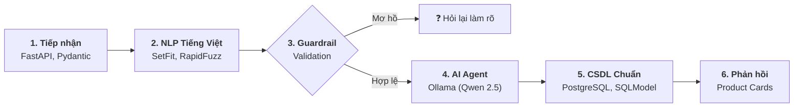

<!-- _class: lead -->
# CHATBOT TƯ VẤN ĐIỆN THOẠI THÔNG MINH
### Hệ thống Tư vấn Đàm thoại Hybrid: NLP Tiếng Việt + PostgreSQL + Local AI Agent

* **Chuyên ngành:** Xử lý Ngôn ngữ Tự nhiên (NLP) & Hệ thống Đàm thoại (CRS)
* **Phương pháp:** Test-Driven & Verification-First (14 buổi thực hiện)
* **Mục tiêu cốt lõi:** Tư vấn chính xác $100\%$, khắc phục triệt để lỗi ảo giác của LLM

---

# SLIDE 1: BÀI TOÁN — LÝ DO CHỌN & MỤC TIÊU

### 📌 Lý do chọn đề tài
* **Ma trận thông số:** Hàng trăm mẫu máy, giá cả và cấu hình (RAM, ROM, Chip, Pin) gây khó cho người mua.
* **Chatbot Rule-based:** Cứng nhắc, dễ gãy khi gặp tiếng lóng tiếng Việt (*"15 củ"*, *"pin trâu"*).
* **Pure LLM (ChatGPT):** Hay bị **ảo giác** (bịa giá, bịa thông số), không tuân thủ $100\%$ ngân sách trần, chi phí API cao.

### 🎯 Mục tiêu đề tài
* **Mô hình Hybrid AI:** Kết hợp NLP hiểu tiếng Việt tự nhiên với CSDL quan hệ chính xác tuyệt đối.
* **PostgreSQL là Single Source of Truth:** $100\%$ thông số và giá bán do CSDL kiểm soát.
* **Tuân thủ lọc cứng $100\%$:** Không bao giờ gợi ý máy vượt ngân sách hoặc sai hãng.
* **Vận hành an toàn:** Chạy Local LLM (Ollama), kiểm soát bằng Tool Whitelist, chi phí 0đ.

---

# SLIDE 2: CÔNG NGHỆ SỬ DỤNG (TECH STACK)

| Khối chức năng | Công nghệ / Thư viện | Vai trò cốt lõi |
|---|---|---|
| **Backend API** | **FastAPI**, **Pydantic v2**, **Uvicorn** | Web API bất đồng bộ, kiểm thực dữ liệu chặt chẽ, sinh Swagger UI tự động. |
| **Cơ sở dữ liệu** | **PostgreSQL 16**, **SQLModel**, **Alembic** | Nguồn sự thật duy nhất, chuẩn hóa quan hệ $N-N$, quản lý migration schema. |
| **NLP Tiếng Việt** | **SetFit**, **Sentence-Transformers** | Phân loại 7 ý định (Few-shot learning trên CPU, chỉ cần 5–8 mẫu/nhãn). |
| **Bóc tách Slot** | **RapidFuzz**, `unicodedata`, `re` | So khớp mờ tên hãng/model, quy đổi tiền tệ lóng (*củ/tr/k*) sang VND. |
| **AI Agent** | **Ollama** (`qwen2.5:3b`), **HTTPX** | Điều phối đàm thoại cục bộ, suy luận gọi tool an toàn, bảo vệ dữ liệu. |
| **Giao diện Chat** | **HTML5, Modern CSS, Vanilla JS** | Giao diện Chat trực quan, hỗ trợ SSE streaming, hiển thị Thẻ sản phẩm. |

---

# SLIDE 3: PIPELINE TỔNG THỂ & THƯ VIỆN CỐT LÕI

### 3 Khối vận hành chính:
1. **Tiếp nhận & NLP (`fastapi`, `setfit`, `rapidfuzz`):** Chuẩn hóa câu nói, bóc tách giá tiền VND, phân loại 7 ý định và trích xuất slot Hãng/Model/Nhu cầu.
2. **Kiểm duyệt & Agent (`python`, `ollama`):** Guardrail chặn gọi tool nếu thiếu ngân sách; Agent chọn tool trong Whitelist.
3. **CSDL & Phản hồi (`sqlmodel`, `postgresql`):** Lọc SQL chuẩn xác $100\%$, xếp hạng theo sở thích, trả về câu trả lời kèm Thẻ sản phẩm.

---

# SLIDE 4: CHI TIẾT NLP (LUỒNG 1) — CHUẨN HÓA & QUY ĐỔI TIỀN TỆ

*Mã nguồn thực hiện: `phone_advisor.nlp.normalize`*

* **Chuẩn hóa chuỗi:** Unicode NFC, xóa khoảng trắng thừa, lưu song song `raw_message` gốc.
* **Quy đổi tiếng lóng tiền tệ về VND:**
  * Đơn vị triệu ($10^6$): `"củ"`, `"chai"`, `"tr"`, `"triệu"` $\rightarrow$ Ví dụ: `"15 củ"` $\rightarrow$ `15.000.000đ`.
  * Đơn vị nghìn ($10^3$): `"k"`, `"lít"` $\rightarrow$ Ví dụ: `"500k"` $\rightarrow$ `500.000đ`.
  * Số lẻ kết hợp: `"12 củ rưỡi"` / `"7tr5"` $\rightarrow$ `12.500.000đ`, `7.500.000đ`.
* **Phân biệt toán tử so sánh (Inclusive vs Exclusive):**
  * `"dưới 15 củ"` $\rightarrow$ `gia_ban < 15.000.000` (loại mốc 15tr).
  * `"tối đa 15tr"`, `"15 củ quay đầu"` $\rightarrow$ `gia_ban <= 15.000.000` (nhận mốc 15tr).
  * `"tầm 10 triệu"` $\rightarrow$ Tự động tạo biên độ $\pm 10\%$ (`[9tr, 11tr]`).
* **Guardrail:** Không đoán mò các từ cảm tính (*"giá rẻ"*, *"sinh viên"*); yêu cầu khách xác nhận giá.

<b>Ví dụ Luồng 1:</b> <i>"Tầm 12 củ rưỡi quay đầu nhé"</i> &nbsp;⟶&nbsp; <code>max_price = 12500000</code>, <code>inclusive = True</code> (≤ 12.5tr).

---

# SLIDE 5: CHI TIẾT NLP (LUỒNG 2) — PHÂN LOẠI Ý ĐỊNH VỚI SETFIT

*Mã nguồn thực hiện: `phone_advisor.nlp.intent` (SetFit Few-Shot trên CPU)*

* **Ưu điểm:** Học tương phản ngữ nghĩa (Contrastive Learning); chỉ cần **5–8 mẫu/nhãn**; chạy cực nhanh ($< 15\text{ms}$).

| Intent | Ý nghĩa nghiệp vụ | Tool ánh xạ tương ứng |
|---|---|---|
| `recommend` | Gợi ý máy theo tiêu chí & sở thích | `recommend_phones(filters, preferences)` |
| `search` | Tìm máy khớp thông số kỹ thuật | `recommend_phones(filters, preferences=[])` |
| `detail` | Xem thông số chi tiết 1 máy | `get_phone_detail(product_id)` |
| `compare` | So sánh 2–3 máy đã rõ ID | `compare_phones(product_ids)` |
| `browse` | Xem danh sách hãng / phân trang | `browse_phones(brand, page)` |
| `greeting` / `out_of_scope` | Chào hỏi / Ngoài phạm vi bán điện thoại | Trả lời tĩnh, **tuyệt đối không gọi Tool** |

<b>Ví dụ Luồng 2:</b> <i>"So sánh Galaxy S25 với Xiaomi 15"</i> &nbsp;⟶&nbsp; <code>intent = "compare"</code> (Score: 0.97) ⟶ Ánh xạ Tool <code>compare_phones</code>.

---

# SLIDE 6: CHI TIẾT NLP (LUỒNG 3) — BÓC TÁCH SLOT & DIALOGUE STATE

*Mã nguồn thực hiện: `nlp.slots`, `nlp.aliases`, `nlp.dialogue_state`*

* **1. Phân tách Filters (Cứng) vs Preferences (Mềm):**
  * **Filters (Lọc cứng - SQL WHERE):** Hãng, trần/sàn giá, RAM tối thiểu $\rightarrow$ Vi phạm là **loại bỏ $100\%$**.
  * **Preferences (Sở thích - Ranking):** *"chơi game"*, *"pin trâu"* $\rightarrow$ Dùng để cộng điểm ưu tiên Top 1–3.
* **2. RapidFuzz & Model đa phiên bản ROM:**
  * So khớp mờ chống sai chính tả: `"ip16 prm"` $\rightarrow$ `"iPhone 16 Pro Max"`.
  * Tránh đoán mò: Hỏi lại nếu 1 model có nhiều bản ROM (ví dụ: *256GB vs 512GB*).
* **3. Dialogue State (Quản lý ngữ cảnh đa lượt, TTL 30 phút):**
  * **Lượt 1:** *"Tìm Samsung dưới 15 củ"* $\rightarrow$ `State: {brand: "Samsung", max_price: 15tr}`
  * **Lượt 2 (Merge):** *"Ưu tiên pin trâu nhé"* $\rightarrow$ `State: {brand: "Samsung", max_price: 15tr, prefs: ["pin_trau"]}`
  * **Lượt 3 (Overwrite):** *"Đổi sang Xiaomi"* $\rightarrow$ `State: {brand: "Xiaomi", max_price: 15tr, prefs: ["pin_trau"]}`

<b>Kết quả Luồng 3:</b> Đóng gói thành <code>ValidatedRequest</code> chuẩn truyền cho Catalog Service, không mất thông tin qua các lượt chat.

