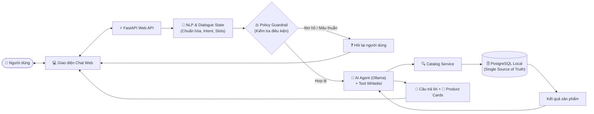
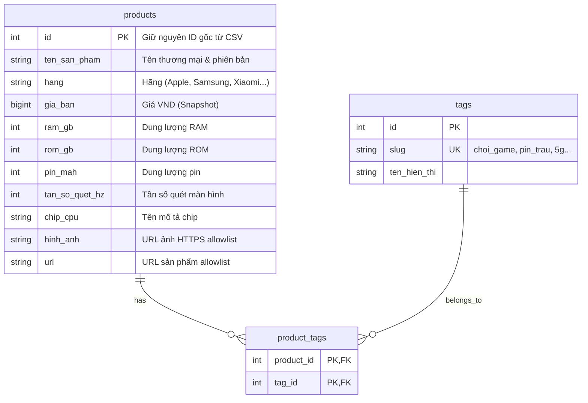

# ĐỀ TÀI: CHATBOT TƯ VẤN ĐIỆN THOẠI THÔNG MINH
### Ứng dụng Xử lý ngôn ngữ tự nhiên Tiếng Việt và AI Agent điều phối trên nền tảng FastAPI & PostgreSQL

* **Lĩnh vực:** Xử lý ngôn ngữ tự nhiên (NLP) & Hệ thống gợi ý đàm thoại (Conversational Recommender System - CRS)
* **Công nghệ cốt lõi:** Python, FastAPI, Uvicorn, SQLModel (Pydantic + SQLAlchemy), PostgreSQL, Alembic, NLP Hybrid Rule-based, Ollama (Qwen 2.5)
* **Nguồn dữ liệu:** Danh mục sản phẩm chuẩn hóa (162 sản phẩm, 17 thuộc tính kỹ thuật)
* **Lộ trình:** 14 giai đoạn triển khai (Test-Driven & Verification-First)

---

# 1. ĐẶT VẤN ĐỀ & MỤC TIÊU NGHIÊN CỨU

### 1. Thực trạng & Thách thức
* **Chatbot kịch bản truyền thống (Rule-based):** Cứng nhắc, không thể hiểu được các câu nói tự nhiên, tiếng lóng phong phú của người dùng (*"15 củ"*, *"pin trâu"*, *"máy mượt"*).
* **Pure LLM Chatbot (ChatGPT / LLM đơn thuần):** 
  * Dễ gặp hiện tượng **ảo giác (Hallucination)**: tự bịa giá bán, cấu hình chip, chính sách bảo hành không có thật.
  * Không truy vấn chính xác danh mục nội bộ thời gian thực; khó áp đặt các điều kiện lọc ngân sách cứng.

### 2. Mục tiêu đề tài
* Xây dựng hệ thống **Hybrid Conversational Agent**:
  * **NLP Tiếng Việt chuyên biệt:** Bóc tách chính xác ý định (Intent), khoảng giá VND và nhu cầu (Slots/Tags).
  * **PostgreSQL là Single Source of Truth:** Cơ sở dữ liệu duy nhất quyết định sản phẩm nào thỏa mãn điều kiện.
  * **AI Agent (Ollama/Qwen):** Đàm thoại linh hoạt, gọi Tool an toàn và giải thích lý do gợi ý máy cho khách hàng.

---

# 2. TỔNG QUAN KIẾN TRÚC HỆ THỐNG



### Nguyên tắc kiến trúc:
1. **Modular Monolith:** Ứng dụng FastAPI độc lập, chia module rõ ràng (`db`, `web`, `nlp`, `agent`, `catalog`), chạy trên máy chủ ASGI Uvicorn hỗ trợ xử lý bất đồng bộ và streaming.
2. **Quyền hạn tối thiểu:** Agent chỉ có quyền đọc Catalog, tuyệt đối không có quyền ghi/sửa database.
3. **Database độc lập:** Website chỉ đọc PostgreSQL; file CSV chỉ dùng để nạp ban đầu qua script seed riêng.

---

# 3. THIẾT KẾ NLP TIẾNG VIỆT (HYBRID PIPELINE)

Hệ thống xử lý câu nói tự nhiên qua 4 bước tuần tự trước khi kích hoạt bất kỳ công cụ nào:

### 1. Chuẩn hóa & Trích xuất thực thể
* **Normalization (`normalize.py`):** Chuẩn hóa Unicode NFC, xử lý dấu câu, giữ nguyên câu gốc tiếng Việt.
* **Price Parsing:** Quy đổi tự động các cách nói tiền về đơn vị VND chuẩn:
  * `"15 củ"`, `"15tr"`, `"15 triệu"` $\longrightarrow$ `15.000.000 VND`.
  * Nhận diện chính xác toán tử: `"dưới 15tr"` ($< 15M$), `"tối đa 15tr"` ($\le 15M$), `"từ 10 đến 15tr"`.

### 2. Phân loại 7 nhóm ý định (Intent)
* `recommend`: Gợi ý sản phẩm kèm lý do (dựa trên sở thích).
* `search`: Tìm kiếm chính xác theo bộ lọc thông số.
* `detail`: Xem chi tiết 1 máy theo ID hoặc tên model rút gọn.
* `compare`: So sánh thông số 2–3 máy.
* `browse`: Khám phá danh mục, danh sách hãng có phân trang.
* `greeting` & `out_of_scope`: Phản hồi bằng câu mẫu cố định, không gọi tool.

### 3. Phân tách Filters (Bắt buộc) và Preferences (Mềm)
* **Filters:** Hãng, ngân sách tối đa/tối thiểu, RAM $\rightarrow$ Lọc cứng bằng SQL `WHERE`.
* **Preferences:** Tag nhu cầu (`choi_game`, `pin_trau`, `chup_anh_dep`) $\rightarrow$ Chấm điểm ưu tiên xếp hạng (Ranking), không loại máy nếu không vi phạm bộ lọc cứng.

---

# 4. DỮ LIỆU & CƠ SỞ DỮ LIỆU POSTGRESQL



### Điểm nhấn thiết kế dữ liệu:
* **Chuẩn hóa quan hệ:** Tách cột `tags_nhu_cau` dạng chuỗi trong CSV thành quan hệ nhiều-nhiều (`products` $\leftrightarrow$ `tags`), giúp JOIN chính xác tuyệt đối, tránh lỗi dò chuỗi con.
* **Kiểm soát bảo mật:** Phân chia 2 roles:
  * `phone_admin`: Quyền DDL, Migration (Alembic) và chạy script Seed dữ liệu.
  * `phone_app`: Quyền duy nhất `SELECT` phục vụ ứng dụng web.

---

# 5. AI AGENT & CƠ CHẾ BẢO VỆ (GUARDRAILS)

Hệ thống sử dụng mô hình **Qwen 2.5 (3B)** chạy cục bộ qua **Ollama**, đóng vai trò giao tiếp có kiểm soát thông qua 4 Tools Whitelist:

| Tên Tool | Trách nhiệm | Ràng buộc bảo vệ |
|---|---|---|
| `recommend_phones` | Gợi ý tối đa 3 máy thỏa bộ lọc và có điểm sở thích cao nhất | Chặn Agent tự nới ngân sách hoặc tự thêm tag |
| `get_phone_detail` | Xem chi tiết 1 máy theo `product_id` | Nếu trùng tên nhiều bản ROM thì bắt buộc phải hỏi lại |
| `compare_phones` | So sánh 2 hoặc 3 máy theo danh sách ID | Chỉ so sánh thông số có trong DB, không bịa benchmark chip |
| `browse_phones` | Xem danh sách hãng hoặc duyệt phân trang (`page_size` $\le 20$) | Sắp xếp ổn định theo giá tăng dần và ID |

### Cơ chế an toàn (Safe Execution & Fallback):
1. **Giới hạn số lần gọi tool:** Tối đa 2 lần gọi tool trong một lượt chat.
2. **System Prompt chống bịa:** Nghiêm cấm tự tạo giá, cấu hình chip hoặc chính sách bảo hành.
3. **Graceful Fallback:** Khi Ollama bị ngắt kết nối hoặc timeout, backend tự động lấy kết quả từ Catalog và hiển thị câu trả lời tĩnh có cấu trúc cho người dùng.

---

# 6. QUẢN LÝ NGỮ CẢNH (DIALOGUE STATE TRACKING)

Khắc phục nhược điểm mất trí nhớ giữa các lượt chat thông qua module `dialogue_state.py`:

```
Lượt 1: "Tìm Samsung dưới 15 triệu"
  └── State: { brand: "Samsung", max_price: 15000000 }

Lượt 2: "Ưu tiên pin trâu nhé"
  └── State (Merge): { brand: "Samsung", max_price: 15000000, preferences: ["pin_trau"] }

Lượt 3: "Đổi sang Xiaomi giúp mình"
  └── State (Overwrite): { brand: "Xiaomi", max_price: 15000000, preferences: ["pin_trau"] }
```

### Các nguyên tắc quản lý State:
* **Cô lập theo Session:** Mỗi người dùng mang một session ID ngẫu nhiên, lưu phía server, không dùng biến toàn cục.
* **Tách rời State & Lịch sử:** Lưu tối đa 5 lượt tin nhắn văn bản làm ngữ cảnh LLM, nhưng lưu cấu trúc `filters` riêng biệt cho Catalog.
* **Thời gian sống (TTL):** Tự động reset state sau 30 phút không hoạt động hoặc khi người dùng gõ *"bắt đầu lại"*.

---

# 7. GIAO DIỆN NGƯỜI DÙNG & TRẢI NGHIỆM CHAT

### 1. Thành phần giao diện (Chat UI)
* Khung chat trực quan, hỗ trợ gõ Enter để gửi, Shift+Enter xuống dòng.
* Hiển thị trạng thái bot đang suy nghĩ / xử lý.
* Thông báo câu hỏi làm rõ (**Clarification Prompt**) rõ ràng khi thông tin bị mơ hồ hoặc mâu thuẫn.

### 2. Thiết kế Thẻ sản phẩm (Product Card)
* Mỗi kết quả gợi ý trả về tối đa 3 thẻ sản phẩm gồm:
  * Hình ảnh sản phẩm (HTTPS allowlist).
  * Tên máy, Hãng, Giá bán VND (ghi chú rõ là giá snapshot từ dữ liệu).
  * Thông số cốt lõi: RAM, ROM, Dung lượng Pin, Chip, Màn hình, Tần số quét.
  * **Lý do gợi ý ngắn gọn:** Ví dụ: *"Khớp ngân sách dưới 15 triệu và có tag pin_trau (6.500mAh)"*.

### 3. An toàn hiển thị (Security)
* Toàn bộ nội dung văn bản được escape an toàn, chặn hoàn toàn nguy cơ tấn công XSS.

---

# 8. LỘ TRÌNH THỰC HIỆN DỰ ÁN (14 BUỔI)

Quy trình phát triển tuần tự theo phương pháp **Test-Driven & Verification-First**:

```
[Buổi 1-2]: Môi trường FastAPI cơ bản ──> Kiểm tra & Validate dữ liệu CSV
      │
[Buổi 3-4]: Schema PostgreSQL (Alembic) ──> Lệnh Seed CSV an toàn & Repository
      │
[Buổi 5-6]: Lọc Catalog (Search/Browse) ──> Ranking sở thích (Recommend/Detail/Compare)
      │
[Buổi 7-9]: Chuẩn hóa NLP tiếng Việt ──> Intent & Slot Parser ──> Dialogue State
      │
[Buổi 10-11]: Tool Schemas & Whitelist ──> Tích hợp AI Agent (Ollama Local)
      │
[Buổi 12-13]: REST API (POST /api/chat) ──> Giao diện Web Chat & Product Cards
      │
[Buổi 14]: Đánh giá định lượng (F1/Accuracy) & Hoàn thiện Kịch bản Demo
```

---

# 9. ĐÁNH GIÁ, KẾT LUẬN & HƯỚNG MỞ RỘNG

### 1. Bộ tiêu chí đánh giá (Evaluation Criteria)
* **Độ tuân thủ điều kiện cứng (Hard constraints compliance):** Đạt **100%** (không bao giờ vượt ngân sách hay sai hãng).
* **Độ chính xác NLP:** Đo lường Intent Accuracy, Slot F1-score trên tập kiểm thử độc lập `evaluation/intent_slots.csv`.
* **Độ ổn định:** Hoạt động trơn tru cả khi Ollama offline nhờ cơ chế fallback.

### 2. Đóng góp nổi bật của đề tài
* Chứng minh hiệu quả của mô hình **Hybrid Agent**: Kết hợp tính chính xác của SQL/Luật với sự linh hoạt, thân thiện của LLM.
* Hệ thống mã nguồn sạch, có kiểm thử tự động, kiến trúc chuẩn mực tương tự các giải pháp nghiên cứu và công nghiệp (Chat-REC, Rasa CALM).

### 3. Hướng mở rộng tương lai
* Tích hợp cơ chế Crawler đồng bộ giá và tồn kho thời gian thực.
* Bổ sung trang quản trị CRUD sản phẩm có phân quyền Admin.
* Thêm RAG tìm kiếm trên tài liệu đánh giá chuyên sâu (Reviews/Articles) khi có kho văn bản dài.

