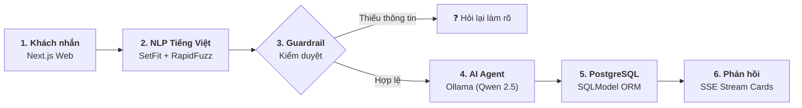

<!-- _class: lead -->
# CHATBOT TƯ VẤN ĐIỆN THOẠI THÔNG MINH
### Hệ thống Tư vấn Đàm thoại Hybrid: NLP Tiếng Việt + PostgreSQL + Local AI Agent

* **Chuyên ngành:** Xử lý Ngôn ngữ Tự nhiên (NLP) & Hệ thống Đàm thoại (CRS)
* **Kiến trúc:** Frontend Next.js + Backend FastAPI + CSDL PostgreSQL (SSOT)
* **Mô hình AI:** Hybrid NLP (SetFit Few-Shot + RapidFuzz) + Local LLM (Ollama / Qwen 2.5)
* **Mục tiêu then chốt:** Tư vấn chính xác $100\%$, khắc phục triệt để lỗi ảo giác của LLM

---

# SLIDE 1: BÀI TOÁN & GIẢI PHÁP HYBRID

### 📌 Thách thức thực tế
* **Ma trận thông số:** Hàng trăm mẫu máy, RAM/ROM/Chip/Giá gây bối rối cho người mua.
* **Chatbot Rule-based:** Cứng nhắc, không hiểu tiếng lóng (*"15 củ"*, *"pin trâu"*).
* **Pure LLM (ChatGPT):** Hay bị **ảo giác** (bịa giá, bịa thông số), không tuân thủ ngân sách trần, chi phí API cao.

### 🎯 Giải pháp Hybrid AI
* **NLP Tiếng Việt chuyên biệt:** Bóc tách tiếng lóng tiền tệ, bắt đúng ý định và nhu cầu.
* **PostgreSQL là Chân lý (SSOT):** Lọc SQL cứng $100\%$ qua SQLModel ORM, không vi phạm giá trần.
* **Local Agent (Qwen 2.5 qua Ollama):** Điều phối thông minh bằng Tool Whitelist, chi phí 0đ.

<b>Ví dụ thực tế:</b> Khách hỏi <i>"Tìm máy tầm 12 củ pin trâu"</i> 
❌ <b>Chatbot thường:</b> Báo lỗi cú pháp hoặc ChatGPT bịa máy 13.5tr. 
✅ <b>Hệ thống Hybrid:</b> Nhận diện trần <code>12.000.000đ</code>, truy vấn đúng CSDL, xếp hạng máy có tag <code>pin_trau</code>.

---

# SLIDE 2: KIẾN TRÚC & PIPELINE TỔNG THỂ

### 3 Nguyên tắc thiết kế cốt lõi:
1. **Zero Hallucination (Không ảo giác):** LLM không tự phát ngôn giá hay cấu hình; toàn bộ do CSDL cung cấp.
2. **Deterministic Filtering (Lọc tiền quyết):** Điều kiện ngân sách và hãng được lọc cứng bằng SQL `WHERE`.
3. **Privacy & Offline:** Vận hành hoàn toàn Local, bảo vệ dữ liệu người dùng, không phụ thuộc mạng ngoài.

---

# SLIDE 3: XỬ LÝ DỮ LIỆU BAN ĐẦU & CHUẨN HÓA CSDL

*Tập dữ liệu: `data/dien_thoai_chuan_hoa.csv` (162 sản phẩm, 17 trường thông số kỹ thuật)*

### 🧹 1. Làm sạch & Kiểm định (Validation)
* **Toàn vẹn khóa:** $100\%$ `id` không rỗng, không trùng lặp.
* **Chuẩn hóa trường số:** Ép kiểu chặt chẽ cho Giá (VND), RAM/ROM (GB), Pin (mAh), Màn hình (inch), Sạc (W).
* **An toàn URL/Ảnh:** Rà soát ảnh HTTPS, chỉ nhận domain thuộc Whitelist cho phép.

### 🗄️ 2. Chuẩn hóa Quan hệ $N-N$ (DB Seeding)
* Cột thô `tags_nhu_cau` dạng chuỗi (*"choi_game, pin_trau"*).
* **Tách chuẩn hóa:** Sinh bảng `tags` và bảng liên kết `product_tags`.
* **Lợi ích:** Lọc SQL chuẩn xác $100\%$, tránh dùng `LIKE '%tag%'` gây chậm và sai lệch kết quả.

<b>Ví dụ xử lý dữ liệu:</b> 
• <i>CSV thô:</i> <code>id=1, ten="Xiaomi 14T", gia=12490000, tags="choi_game, pin_trau"</code> 
⟶ <b>Seed vào PostgreSQL:</b> Lưu thông số vào bảng <code>products</code>; tự động tách thành 2 bản ghi liên kết <code>(id=1, tag="choi_game")</code> và <code>(id=1, tag="pin_trau")</code> trong <code>product_tags</code>.

---

# SLIDE 4: NLP TIẾNG VIỆT (1) — CHUẨN HÓA & QUY ĐỔI TIỀN TỆ

*Mã nguồn thực hiện: `phone_advisor.nlp.normalize`*

* **Chuẩn hóa chuỗi:** Unicode NFC, làm sạch ký tự lạ, giữ nguyên câu gốc để đối chiếu.
* **Bóc tách tiếng lóng tiền tệ về số VND chuẩn:**
  * Hàng triệu: `"củ"`, `"chai"`, `"tr"`, `"triệu"` $\rightarrow$ `"15 củ"` = `15.000.000đ`.
  * Hàng trăm nghìn: `"k"`, `"lít"` $\rightarrow$ `"500k"` = `500.000đ`.
  * Số lẻ linh hoạt: `"12 củ rưỡi"` = `12.500.000đ`; `"7tr5"` = `7.500.000đ`.
* **Phân định toán tử logic:**
  * `"dưới 15 củ"` $\rightarrow$ `gia_ban < 15.000.000` (loại mốc 15tr).
  * `"15 củ quay đầu"` / `"tối đa 15tr"` $\rightarrow$ `gia_ban <= 15.000.000` (nhận mốc 15tr).
  * `"tầm 10 triệu"` $\rightarrow$ Tự động mở biên độ $\pm 10\%$ (`[9.000.000đ, 11.000.000đ]`).

<b>Ví dụ xử lý:</b> <i>"Có con Xiaomi nào 7 củ rưỡi quay đầu không shop?"</i> 
⟶ <b>Kết quả:</b> <code>brand = "Xiaomi"</code>, <code>max_price = 7.500.000đ</code>, <code>max_price_inclusive = True</code>.

---

# SLIDE 5: NLP TIẾNG VIỆT (2) — PHÂN LOẠI Ý ĐỊNH & BÓC TÁCH SLOT

### 🧠 7 Intent với SetFit (Few-shot)
* Chạy siêu nhanh trên CPU ($< 15\text{ms}$).
* Chỉ cần **5–8 mẫu/nhãn** huấn luyện:
  * `recommend`: Gợi ý máy theo tiêu chí.
  * `search`: Tìm theo thông số kỹ thuật.
  * `detail`: Xem chi tiết 1 sản phẩm.
  * `compare`: So sánh 2–3 máy.
  * `browse`: Xem danh sách hãng / phân trang.
  * `greeting` / `out_of_scope`: Chào hỏi, ngoài lề.

### 🔍 Slot & Xử lý Model (RapidFuzz)
* **Filters (Lọc cứng):** Hãng, Giá, RAM $\rightarrow$ Loại bỏ $100\%$ máy không khớp.
* **Preferences (Sở thích):** *"chơi game"*, *"pin trâu"* $\rightarrow$ Cộng điểm Ranking top 1–3.
* **So khớp mờ:** `"ip16 prm"` $\rightarrow$ `"iPhone 16 Pro Max"`.
* **Đa bản ROM thông minh:** Tự chọn bản chuẩn / tối ưu giá, kèm hiển thị các bản khác (tránh hỏi lại rườm rà).

<b>Ví dụ bóc tách:</b> <i>"So sánh ip 16 prm với S25 Ultra"</i> 
⟶ <code>intent = "compare"</code>, <code>targets = ["iPhone 16 Pro Max", "Galaxy S25 Ultra"]</code>.

---

# SLIDE 6: GUARDRAILS & AI AGENT TOOL WHITELIST

### 🛡️ Guardrails (Chặn trước khi gọi AI)
* **Thiếu ngân sách:** Câu hỏi mơ hồ (*"tư vấn máy tốt"*) $\rightarrow$ Nhắc khách đưa mức giá thay vì đoán bừa.
* **Mâu thuẫn:** Giá sàn $>$ Giá trần $\rightarrow$ Nhắc khách chỉnh lại.
* **Ngoài phạm vi:** Hỏi thời tiết, code $\rightarrow$ Từ chối lịch sự, không gọi Tool CSDL.

### ⚙️ Tool Whitelist (Agent chỉ gọi 4 tool)
1. `recommend_phones(filters, preferences)`
2. `get_phone_detail(product_id)`
3. `compare_phones(product_ids)`
4. `browse_phones(brand, page)`
* **Bảo mật:** Agent không được chạy SQL tùy tiện, chống Prompt Injection.

<b>Ví dụ chống ảo giác:</b> Khách hỏi <i>"Pin iPhone 16 Pro Max dùng được mấy tiếng?"</i> 
⟶ Agent gọi <code>get_phone_detail(id)</code> lấy đúng số liệu từ CSDL (Pin 4685 mAh, xem video 33h) để trả lời, không tự bịa số.

---

# SLIDE 7: GIAO DIỆN WEB NEXT.JS & THẺ SẢN PHẨM

### 💻 Frontend Next.js Hiện đại
* **Kiến trúc tách rời:** Next.js (React) kết nối FastAPI qua RESTful API & SSE.
* **SSE Streaming:** Nhận phản hồi từng từ theo thời gian thực, mượt mà như ChatGPT.
* **Quản lý State:** Hiển thị lịch sử chat trực quan, tự động cuộn thông minh.

### 📱 Xiaomi 14T 5G (12GB / 512GB)
* **Giá bán:** **12.490.000đ** *(Thỏa mãn trần 15 củ)*
* **Thông số:** Dimensity 8300-Ultra • AMOLED 144Hz • Pin 5000 mAh
* **Đặc điểm:** Chơi gamePin trâuSạc 67W
* *Có tùy chọn bản 256GB giá 11.490.000đ*

<b>Trải nghiệm mua sắm:</b> Vừa có lời tư vấn thân thiện như nhân viên thật, vừa có Thẻ sản phẩm (Product Card) để xem nhanh và ra quyết định.

---

# SLIDE 8: KẾT LUẬN & ĐIỂM NỔI BẬT

### 🌟 4 Điểm nổi bật của đề tài
1. **Chính xác $100\%$:** CSDL PostgreSQL là nguồn sự thật duy nhất, xóa bỏ triệt để ảo giác thông số và giá.
2. **Hiểu tiếng Việt tự nhiên:** Xử lý mượt mà tiếng lóng tiền tệ, viết tắt model, phân loại ý định chuẩn xác.
3. **Chi phí 0đ:** Vận hành Local hoàn toàn với SetFit trên CPU và Qwen 2.5 (3B) qua Ollama.
4. **Trải nghiệm thực tế:** Kết hợp giao diện Next.js hiện đại và Thẻ sản phẩm tương tác trực quan.

### 🚀 Hướng phát triển tương lai
* **Đồng bộ thời gian thực:** Kết nối API tồn kho thực tế của chuỗi bán lẻ.
* **Tích hợp giỏ hàng:** Đặt hàng và thanh toán trực tiếp trong luồng chat.
* **Đa phương thức (Multimodal):** Nhận diện điện thoại qua ảnh chụp của người dùng.

Hệ thống kết hợp hài hòa giữa Độ chính xác tuyệt đối của Kỹ thuật phần mềm và Trải nghiệm thông minh của AI.

