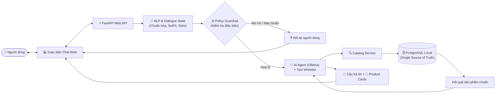
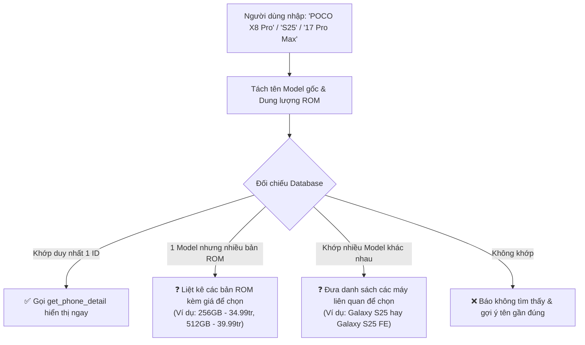
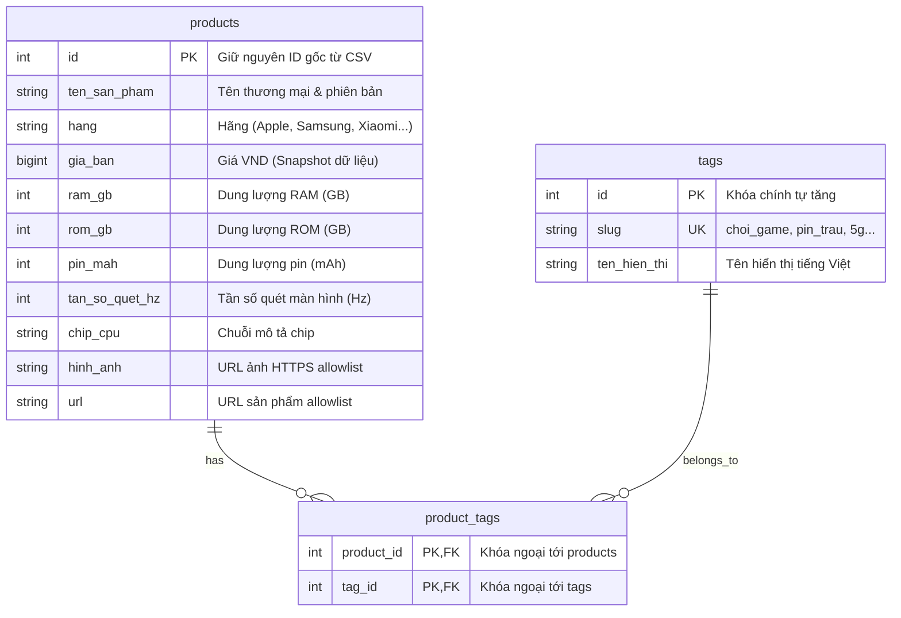

<!-- _class: lead -->
# ĐỀ TÀI: CHATBOT TƯ VẤN ĐIỆN THOẠI THÔNG MINH
### Ứng dụng Xử lý ngôn ngữ tự nhiên Tiếng Việt & AI Agent điều phối trên nền tảng FastAPI & PostgreSQL

* **Chuyên ngành:** Xử lý ngôn ngữ tự nhiên (NLP) & Hệ thống gợi ý đàm thoại (CRS)
* **Kiến trúc cốt lõi:** Modular Monolith (FastAPI ASGI) + PostgreSQL (Single Source of Truth)
* **Mô hình AI:** Hybrid NLP (SetFit Few-Shot + RapidFuzz) + Local LLM Agent (Ollama / Qwen 2.5)
* **Quy trình:** 14 buổi phát triển theo phương pháp Test-Driven & Verification-First

---

# MỤC LỤC BÁO CÁO

1. **Đặt vấn đề & Mục tiêu nghiên cứu** (Thực trạng, thách thức và giải pháp Hybrid)
2. **Tổng quan kiến trúc hệ thống** (Sơ đồ luồng, phân rã module & 3 nguyên tắc nền tảng)
3. **Thiết kế NLP Tiếng Việt Hybrid** (Normalize, SetFit Few-Shot, RapidFuzz, Filters vs Preferences)
4. **Cơ sở dữ liệu PostgreSQL & Dữ liệu sản phẩm** (Schema N-N, snapshot giá, seed an toàn)
5. **AI Agent & Cơ chế bảo vệ (Guardrails)** (Tool Whitelist, Prompt chống ảo giác, Fallback)
6. **Quản lý ngữ cảnh hội thoại (Dialogue State)** (Session isolation, merge state, TTL)
7. **Giao diện Chat & Hợp đồng API** (REST API, Swagger, SSE Streaming, Product Cards, Security)
8. **Kịch bản kiểm thử & Các ca hội thoại điển hình** (Case studies thực tế)
9. **Lộ trình 14 buổi thực hiện & Đánh giá định lượng** (Milestones, Metrics F1/Accuracy)
10. **Kết luận & Hướng mở rộng** (Đóng góp đề tài và tiềm năng phát triển)

---

# 1. ĐẶT VẤN ĐỀ & THÁCH THỨC THỰC TIỄN

<div class="grid-2">

<div>

### 🛑 Chatbot kịch bản (Rule-based)
* Cứng nhắc, dựa vào so khớp từ khóa cố định (`if/else`).
* Không xử lý được ngữ cảnh tự nhiên, tiếng lóng phong phú:
  * *"15 củ"*, *"tầm chục triệu"*
  * *"pin trâu"*, *"máy mượt"*, *"chụp choẹt đẹp"*
* Khó mở rộng khi danh mục sản phẩm thay đổi hoặc phát sinh nhu cầu mới.

</div>

<div>

### 🛑 Pure LLM Chatbot (ChatGPT đơn thuần)
* Hiện tượng **Ảo giác (Hallucination)**: tự bịa giá bán, cấu hình chip, chính sách bảo hành không có thật.
* Không có kết nối dữ liệu thời gian thực tới kho hàng nội bộ.
* Không đảm bảo **100% tuân thủ điều kiện lọc cứng** (ngân sách trần, đúng hãng sản xuất).
* Phụ thuộc API bên ngoài, chi phí cao và rủi ro bảo mật dữ liệu.

</div>

</div>

> [!IMPORTANT]
> **Nhu cầu cấp thiết:** Cần một giải pháp kết hợp sự **chính xác tuyệt đối của cơ sở dữ liệu quan hệ** với **sự linh hoạt, tự nhiên của mô hình ngôn ngữ lớn**.

---

# 1. MỤC TIÊU ĐỀ TÀI & ĐỊNH HƯỚNG GIẢI PHÁP

### Xây dựng mô hình Hybrid Conversational Agent:

* **1. Xử lý ngôn ngữ tự nhiên Tiếng Việt chuyên biệt (NLP Layer):**
  * Chuẩn hóa Unicode NFC, xử lý phương ngữ, bóc tách giá tiền VND chính xác (`normalize.py`).
  * Phân loại 7 ý định người dùng bằng **SetFit Few-Shot Learning** dựa trên ngữ nghĩa câu.
  * Phân tách rành mạch: **Filters** (điều kiện lọc cứng) vs **Preferences** (sở thích xếp hạng).

* **2. PostgreSQL là Nguồn dữ liệu chuẩn duy nhất (Single Source of Truth):**
  * Toàn bộ việc lọc, so sánh và xác thực sản phẩm đều do PostgreSQL và Catalog Service đảm nhiệm.
  * AI Agent tuyệt đối không tự bịa sản phẩm, không tự nới ngân sách của khách.

* **3. AI Agent điều phối an toàn (Ollama / Qwen 2.5):**
  * Chạy mô hình cục bộ (Local LLM), kiểm soát thông qua **Tool Whitelist** và **Guardrails**.
  * Diễn đạt câu trả lời thân thiện, giải thích rõ lý do gợi ý máy theo từng nhu cầu.

---

# 2. TỔNG QUAN KIẾN TRÚC HỆ THỐNG



---

# 2.1. CHI TIẾT LUỒNG XỬ LÝ: PHẦN 1 (TIẾP NHẬN & NLP)

* **Bước 1 — Người dùng:** Nhập câu hỏi tự nhiên qua trình duyệt Web.
* **Bước 2 — Giao diện Chat Web:** Gửi payload JSON tới API và nhận phản hồi (hỗ trợ streaming SSE).
* **Bước 3 — FastAPI Web API:** Xác thực Pydantic schema, nhận diện session người dùng và chuyển vào pipeline.
* **Bước 4 — NLP Tiếng Việt & Dialogue State:**
  * Chuẩn hóa Unicode NFC, quy đổi tiền tệ VND chuẩn (`15 củ` $\rightarrow$ `15.000.000đ`).
  * Nhận diện 1 trong 7 Intent bằng mô hình **SetFit Few-Shot** (học từ `evaluation/intent_slots.csv`).
  * Bóc tách các Slot thông số (hãng, model, khoảng giá, min specs, tag nhu cầu).
* **Bước 5 — Policy Guardrail (Kiểm tra nghiệp vụ):**
  * *Nếu mơ hồ hoặc mâu thuẫn:* Chuyển sang **Bước 6** sinh câu hỏi làm rõ (**Clarification Prompt**), trả về UI ngay, không gọi Tool/LLM.
  * *Nếu hợp lệ:* Đóng gói `ValidatedRequest` chuẩn chuyển sang **Bước 7**.

---

# 2.2. CHI TIẾT LUỒNG XỬ LÝ: PHẦN 2 (AGENT & DATABASE)

* **Bước 7 — AI Agent (Ollama Local) + Tool Whitelist:**
  * Nhận câu hỏi gốc kèm request đã xác thực; Agent suy nghĩ và chọn Tool tương ứng với Intent.
  * Backend kiểm tra đối số: Agent không được phép tự nới giá hay tự thêm tag.
* **Bước 8 — Catalog Service:** Nhận lệnh truy vấn đã được kiểm duyệt, thực thi logic lọc và xếp hạng.
* **Bước 9 — PostgreSQL Local:** Nguồn dữ liệu quan hệ duy nhất (`products`, `tags`, `product_tags`).
* **Bước 10 — Kết quả cấu trúc:** Catalog trả về danh sách sản phẩm khớp điều kiện kèm thông số chi tiết.
* **Bước 11 — Diễn đạt kết quả & Product Cards:**
  * Agent soạn câu trả lời thân thiện, giải thích ưu/nhược điểm từng máy dựa trên dữ liệu thật.
  * Backend ghép thẻ sản phẩm (**Product Card**) trực quan (ảnh, tên, giá snapshot, thông số, lý do gợi ý).

---

# 2.3. BA NGUYÊN TẮC KIẾN TRÚC CỐT LÕI

### 1. Modular Monolith (FastAPI ASGI)
* Ứng dụng độc lập, chia module rõ ràng: `db`, `web`, `nlp`, `agent`, `catalog`.
* Chạy trên máy chủ Uvicorn bất đồng bộ, hỗ trợ kết nối đồng thời và truyền dữ liệu thời gian thực (SSE).
* Không lạm dụng microservice để tránh phức tạp hóa hạ tầng cho phạm vi đồ án.

### 2. Nguyên tắc Quyền hạn tối thiểu (Least Privilege)
* **AI Agent:** Chỉ có quyền đọc Catalog thông qua 4 Tool cố định; **tuyệt đối không có quyền ghi/sửa database**.
* **Phân quyền Database PostgreSQL:**
  * `phone_admin`: Quyền DDL, Migration (Alembic) và chạy script Seed dữ liệu.
  * `phone_app`: Quyền duy nhất `SELECT` phục vụ ứng dụng runtime.

### 3. PostgreSQL là Single Source of Truth
* Website chỉ đọc PostgreSQL khi đang phục vụ người dùng.
* File CSV chỉ là dữ liệu nạp ban đầu qua lệnh seed riêng (`scripts/seed_catalog.py`), **không đọc CSV lúc app chạy**.

---

# 3. THIẾT KẾ NLP TIẾNG VIỆT: CHUẨN HÓA & INTENT

Hệ thống xử lý câu nói tự nhiên qua pipeline chuyên biệt độc lập trước khi kích hoạt bất kỳ công cụ nào:

### 1. Chuẩn hóa & Xử lý số tiền (`normalize.py`)
* Chuẩn hóa Unicode NFC, xử lý dấu câu, giữ nguyên câu gốc tiếng Việt để hiển thị.
* Quy đổi tự động các biến thể tiền tệ về số nguyên VND chuẩn:
  * `"15 củ"`, `"15tr"`, `"15 triệu"` $\longrightarrow$ `15.000.000 VND`.
  * Phân biệt chính xác toán tử so sánh:
    * `"dưới 15tr"` ($< 15.000.000$ — loại trừ mốc 15tr).
    * `"tối đa 15tr"` ($\le 15.000.000$ — nhận cả mốc 15tr).
    * `"từ 10 đến 15tr"` ($10.000.000 \le \text{giá} \le 15.000.000$).

### 2. Phân loại 7 nhóm Intent bằng SetFit Few-Shot Learning
* Sử dụng mô hình **SetFit** kết hợp mô hình nền Sentence Transformer đa ngữ.
* Huấn luyện trên tập gán nhãn độc lập `evaluation/intent_slots.csv` (5–8 mẫu/nhãn, train mất ~30s trên CPU).
* Nhận diện ngữ nghĩa sâu sắc, bắt chính xác tiếng lóng (*"quay đầu"*, *"chụp choẹt"*), độ chính xác > 90%.

---

# 3.1. DANH SÁCH 7 Ý ĐỊNH (INTENT TAXONOMY)

| Intent | Trách nhiệm nghiệp vụ | Ánh xạ Tool | Ví dụ câu hỏi |
|---|---|---|---|
| `recommend` | Gợi ý tối đa 3 máy thỏa điều kiện và có điểm sở thích cao nhất | `recommend_phones` (kèm prefs) | *"Gợi ý máy chụp ảnh đẹp dưới 15 củ"* |
| `search` | Tìm máy khớp chính xác bộ lọc thông số; không xếp hạng sở thích | `recommend_phones` (prefs rỗng) | *"Có máy Samsung nào RAM từ 8GB không?"* |
| `detail` | Xem thông số chi tiết 1 máy; hỏi lại nếu tên khớp nhiều bản ROM | `get_phone_detail` | *"Cho mình xem thông tin POCO X8 Pro"* |
| `compare` | So sánh thông số kỹ thuật 2–3 máy đã xác định rõ ID | `compare_phones` | *"So sánh Galaxy S25 với Xiaomi 15"* |
| `browse` | Khám phá danh mục, danh sách hãng có phân trang | `browse_phones` | *"Có những hãng nào?", "Xem tất cả OPPO"* |
| `greeting` | Chào hỏi thân thiện, hướng dẫn cách sử dụng | Không gọi Tool (mẫu tĩnh) | *"Xin chào", "Hello shop"* |
| `out_of_scope` | Từ chối lịch sự các câu hỏi ngoài phạm vi tư vấn máy | Không gọi Tool (mẫu tĩnh) | *"Shop có bán laptop không?", "Bảo hành sao"* |

---

# 3.2. TRÍCH XUẤT SLOT: FILTERS VS PREFERENCES

<div class="grid-2">

<div>

### 🔒 Filters (Bộ lọc cứng — SQL WHERE)
* Các tiêu chí bắt buộc người dùng yêu cầu:
  * **Hãng:** Apple, Samsung, Xiaomi, OPPO...
  * **Ngân sách:** Min/Max VND (kèm cờ inclusive).
  * **Cấu hình tối thiểu:** RAM $\ge$ 8GB, Pin $\ge$ 5000mAh...
  * **Tag bắt buộc:** `"phải có 5G"`, `"bắt buộc máy gập"`.
  * **Loại trừ:** `"không lấy Samsung"` $\rightarrow$ `excluded_brands`.
* 👉 **Quy tắc:** Máy không thỏa mãn điều kiện cứng sẽ bị **loại bỏ hoàn toàn** khỏi kết quả.

</div>

<div>

### 🌟 Preferences (Sở thích mềm — Ranking)
* Nhu cầu mang tính chất định hướng sở thích:
  * `"chơi game"`, `"pin trâu"`, `"chụp ảnh đẹp"`...
* Ánh xạ từ điển đồng nghĩa (`aliases.py`):
  * *"pin khỏe / pin khủng"* $\rightarrow$ `any_of: [pin_trau, pin_khung]`.
* 👉 **Quy tắc:**
  * **Không bao giờ loại máy** nếu máy không có tag sở thích (miễn là thỏa điều kiện lọc cứng).
  * Dùng để cộng điểm `priority` và xếp hạng vị trí hiển thị ưu tiên.

</div>

</div>

---

# 3.3. XỬ LÝ MODEL RÚT GỌN & ĐA PHIÊN BẢN ROM

Người dùng thường gọi tên máy rút gọn. Module `aliases.py` sử dụng thư viện **RapidFuzz** để xử lý thông minh:



---

# 4. THIẾT KẾ CƠ SỞ DỮ LIỆU POSTGRESQL



---

# 4.1. QUẢN LÝ DỮ LIỆU & VÒNG ĐỜI SEED

### 1. Chuẩn hóa quan hệ nhiều-nhiều ($N-N$)
* Tách chuỗi `tags_nhu_cau` trong CSV thành bảng trung gian `product_tags`.
* Loại bỏ triệt để lỗi tìm kiếm chuỗi con (substring search); hỗ trợ SQL `JOIN` chính xác tuyệt đối.

### 2. Bản chất "Snapshot" của dữ liệu giá
* Toàn bộ giá bán trong database là ảnh chụp (snapshot) tại thời điểm thu thập dữ liệu (162 máy).
* **Quy tắc hệ thống:** Bot không được tự nhận là *"giá thị trường hôm nay"* hay *"giá rẻ nhất"* nếu không có trường thời gian chứng minh.

### 3. Quy trình Seed dữ liệu an toàn (`seed_catalog.py`)
* Chạy migration Alembic tạo bảng trước khi seed.
* Lệnh seed độc lập: `python -m scripts.seed_catalog --file data/dien_thoai_chuan_hoa.csv`.
* **Tuyệt đối không seed tự động khi khởi động FastAPI** để tránh nghẽn server và ghi đè dữ liệu.
* Cơ chế Transaction: Rollback toàn bộ nếu phát hiện bất kỳ dòng nào bị lỗi kiểu dữ liệu hoặc trùng khóa.

---

# 5. AI AGENT & TOOL WHITELIST GUARDRAILS

Hệ thống tích hợp mô hình **Qwen 2.5 (3B)** chạy local qua **Ollama**, đóng vai trò giao tiếp có kiểm soát qua 4 Tools:

| Tên Tool | Trách nhiệm chính | Ràng buộc bảo vệ (Guardrails) |
|---|---|---|
| `recommend_phones` | Gợi ý tối đa 3 máy thỏa bộ lọc cứng và có điểm sở thích cao nhất | Chặn Agent tự ý nới ngân sách hoặc tự bịa thêm tag |
| `get_phone_detail` | Lấy đầy đủ thông số kỹ thuật 1 máy theo `product_id` | Nếu ID không tồn tại hoặc trùng model nhiều ROM thì bắt buộc phải hỏi lại |
| `compare_phones` | So sánh 2 hoặc 3 máy theo danh sách ID xác định | Chỉ so sánh thông số có trong DB; cấm bịa benchmark chip |
| `browse_phones` | Liệt kê danh mục hãng hoặc xem danh sách có phân trang | Giới hạn `page_size` $\le 20$; sắp xếp ổn định theo giá tăng dần |

### Kiểm soát an toàn (Safe Execution):
1. **Tool Whitelist:** Backend chỉ đăng ký duy nhất 4 hàm trên; từ chối mọi yêu cầu gọi hàm lạ từ Agent.
2. **Giới hạn số lượt gọi:** Tối đa **2 lần gọi tool** trong 1 lượt hội thoại để tránh vòng lặp vô tận (infinite loop).
3. **Quyền hạn chỉ đọc:** Tất cả Tool chỉ thực hiện truy vấn `SELECT`, không có quyền thêm/sửa/xóa database.

---

# 5.1. PROMPT CHỐNG ẢO GIÁC & DỰ PHÒNG NGOẠI TUYẾN

<div class="grid-2">

<div>

### 🛡️ System Prompt Chống Bịa (Anti-Hallucination)
* **Quy tắc 1:** Chỉ nêu giá và thông số kỹ thuật có trong kết quả trả về của Tool.
* **Quy tắc 2:** Khi nói về chip CPU, chỉ đọc chuỗi mô tả trong DB; **cấm kết luận chip nào mạnh hơn** nếu không có dữ liệu benchmark chính thức.
* **Quy tắc 3:** Khi không tìm thấy sản phẩm, thông báo rõ ràng và hỏi khách hàng muốn nới điều kiện nào; **không tự gợi ý máy sai điều kiện**.
* **Quy tắc 4:** Mỗi gợi ý bắt buộc phải kèm lý do ngắn gọn gắn liền với thuộc tính kỹ thuật thực tế.

</div>

<div>

### ⚡ Cơ chế Fallback khi Ollama Offline
* Nếu tiến trình Ollama bị tắt, quá tải hoặc phản hồi vượt quá thời gian chờ (Timeout):
  * Hệ thống **không báo lỗi sập server (500)**.
  * Backend tự động lấy kết quả cấu trúc từ Catalog Service.
  * Sinh câu trả lời tĩnh có định dạng chuẩn gửi về cho người dùng kèm đầy đủ **Product Cards**.
* 👉 Đảm bảo website luôn hoạt động ổn định và sẵn sàng phục vụ 24/7.

</div>

</div>

---

# 6. QUẢN LÝ NGỮ CẢNH (DIALOGUE STATE TRACKING)

Khắc phục nhược điểm "mất trí nhớ" giữa các lượt chat thông qua module `dialogue_state.py`:

```
Lượt 1: "Tìm Samsung dưới 15 triệu"
  └── State: { brand: "Samsung", max_price: 15000000 }

Lượt 2: "Ưu tiên pin trâu nhé"
  └── State (Merge): { brand: "Samsung", max_price: 15000000, preferences: ["pin_trau"] }

Lượt 3: "Đổi sang Xiaomi giúp mình"
  └── State (Overwrite brand): { brand: "Xiaomi", max_price: 15000000, preferences: ["pin_trau"] }

Lượt 4: "Bắt đầu lại"
  └── State (Reset): {}
```

### Các nguyên tắc quản lý State:
* **Cô lập theo Session:** Mỗi phiên mang một session ID ngẫu nhiên, lưu server-side, không dùng biến toàn cục.
* **Tách rời State & Lịch sử:** Lưu tối đa 5 lượt tin nhắn văn bản làm ngữ cảnh LLM, nhưng lưu cấu trúc `filters` riêng biệt cho Catalog.
* **Thời gian sống (TTL):** Tự động reset state sau 30 phút không hoạt động hoặc khi nhận lệnh *"bắt đầu lại"*.

---

# 7. GIAO DIỆN NGƯỜI DÙNG & PRODUCT CARDS

<div class="grid-2">

<div>

### 💻 Trải nghiệm Chat UI
* Khung chat hiện đại, responsive, hỗ trợ phím Enter để gửi và Shift+Enter xuống dòng.
* Hiển thị trạng thái bot đang suy nghĩ (Loading indicator).
* Hộp thông báo **Clarification Prompt** nổi bật khi cần hỏi thêm thông tin (ngân sách, bản ROM...).
* Hỗ trợ phản hồi Streaming thời gian thực (SSE).

</div>

<div>

### 📱 Thẻ sản phẩm (Product Card)
* Mỗi kết quả gợi ý trả về tối đa 3 thẻ sản phẩm gồm:
  * **Hình ảnh sản phẩm:** URL HTTPS thuộc allowlist.
  * **Tên & Hãng:** Đầy đủ phiên bản ROM.
  * **Giá bán:** Định dạng VND kèm chú thích snapshot.
  * **Thông số:** RAM, ROM, Pin, Chip, Tần số quét.
  * **Lý do gợi ý:** *"Khớp tầm giá < 15tr và pin trâu 6.500mAh"*.
  * **Liên kết:** Nút xem chi tiết / đường dẫn gốc.

</div>

</div>

---

# 7.1. HỢP ĐỒNG API & AN TOÀN BẢO MẬT

### 1. Hợp đồng API `POST /api/chat`
* Payload gửi lên: `{ "message": "Tìm Xiaomi dưới 15 triệu" }`.
* Tự động xác thực dữ liệu qua Pydantic (`BaseModel`), chặn tin nhắn rỗng (mã lỗi 422).
* Phản hồi JSON có cấu trúc thống nhất:
  ```json
  {
    "status": "ok",
    "reply": "Dưới đây là 3 mẫu Xiaomi phù hợp nhất với ngân sách dưới 15 triệu...",
    "products": [ { "id": 57, "ten_san_pham": "Xiaomi POCO X8 Pro", "gia_ban": 12990000, ... } ],
    "clarification": null
  }
  ```
* Tự động sinh tài liệu API trực quan tại Swagger UI (`/docs`).

### 2. Kiểm soát an toàn hiển thị & Bảo mật Web
* **Chống tấn công XSS:** Toàn bộ nội dung trả về từ LLM được escape HTML trước khi render.
* **Domain Allowlist:** Chỉ tải hình ảnh và liên kết ngoài từ các domain được cấu hình trong whitelist.
* **Security Headers:** Cấu hình CSP, `X-Content-Type-Options`, `SameSite` & `HttpOnly` cookie session.

---

# 8. KỊCH BẢN HỘI THOẠI MẪU (CASE STUDIES)

<div class="grid-2">

<div>

#### Case 1: Đủ thông tin (Happy Path)
* **User:** *"Tìm giúp mình Xiaomi chơi game, pin trâu, dưới 15 củ"*
* **Hệ thống:**
  * Lọc cứng: `hang = 'Xiaomi'`, `gia_ban < 15000000`.
  * Xếp hạng: ưu tiên `choi_game`, `pin_trau`.
  * Trả về: POCO X8 Pro (12.99tr), Redmi Note 17 Pro Max (14.19tr) kèm giải thích chi tiết.

#### Case 2: Thiếu ngân sách
* **User:** *"Mình muốn tìm máy chụp ảnh đẹp"*
* **Hệ thống:** Gợi ý sơ bộ theo tag `chup_anh_dep`, thông báo chưa lọc giá và hỏi: *"Bạn dự kiến chi trong khoảng bao nhiêu triệu?"*.

</div>

<div>

#### Case 3: Câu hỏi tiếp nối (Contextual)
* **User (Turn 1):** *"Tìm Samsung dưới 15 triệu"*
* **User (Turn 2):** *"Ưu tiên pin trâu nhé"*
* **Hệ thống:** Giữ nguyên hãng Samsung và trần giá 15tr từ Turn 1, xếp hạng lại máy có pin lớn nhất lên đầu.

#### Case 4: Không có sản phẩm thỏa mãn
* **User:** *"Tìm iPhone dưới 3 triệu, RAM 16GB"*
* **Hệ thống:** Tuyệt đối không tự nới điều kiện: *"Không có máy iPhone nào dưới 3 triệu có RAM 16GB. Bạn có muốn tăng ngân sách không?"*.

</div>

</div>

---

# 9. LỘ TRÌNH THỰC HIỆN DỰ ÁN (14 BUỔI)

Quy trình phát triển tuần tự theo phương pháp **Test-Driven & Verification-First**:

```
[Buổi 1-2]: Môi trường FastAPI cơ bản ──> Kiểm tra & Validate dữ liệu CSV
      │
[Buổi 3-4]: Schema PostgreSQL (Alembic) ──> Lệnh Seed CSV an toàn & Repository
      │
[Buổi 5-6]: Lọc Catalog (Search/Browse) ──> Ranking sở thích (Recommend/Detail/Compare)
      │
[Buổi 7-9]: Chuẩn hóa NLP tiếng Việt ──> Intent & Slot Parser ──> Dialogue State
      │
[Buổi 10-11]: Tool Schemas & Whitelist ──> Tích hợp AI Agent (Ollama Local)
      │
[Buổi 12-13]: REST API (POST /api/chat) ──> Giao diện Web Chat & Product Cards
      │
[Buổi 14]: Đánh giá định lượng (F1/Accuracy) & Hoàn thiện Kịch bản Demo
```

---

# 9.1. CHI TIẾT CÁC MỐC BÀN GIAO TỪNG BUỔI

| Buổi | Tên công việc | Mốc bàn giao kỹ thuật (Deliverable) |
|:---:|---|---|
| **1–2** | Khung dự án & Khảo sát dữ liệu | App FastAPI chạy Uvicorn (`/health`, `/docs`), Data Dictionary 162 máy |
| **3–4** | PostgreSQL Database & Seed | Schema Alembic (`products`, `tags`), Script seed độc lập, Catalog Repository |
| **5–6** | Catalog Service Core | Hoàn thành nghiệp vụ: Search, Browse phân trang, Recommend ranking, Compare |
| **7–8** | NLP Pipeline Tiếng Việt | `normalize.py` quy đổi tiền VND, SetFit Intent classifier, Slot extractor |
| **9** | Dialogue State Tracking | Session state lưu server-side, merge điều kiện câu tiếp nối, TTL reset |
| **10–11** | Tool Whitelist & Ollama Agent | Whitelist 4 Tools, System Prompt chống bịa, kết nối Qwen 2.5, Fallback offline |
| **12–13** | REST API & Web Chat UI | Endpoint `POST /api/chat`, Swagger UI, giao diện Chat, Product Cards trực quan |
| **14** | Đánh giá & Hoàn thiện Demo | Báo cáo kiểm thử F1/Accuracy, kịch bản Demo hoàn chỉnh chạy lặp lại được |

---

# 10. BỘ TIÊU CHÍ ĐÁNH GIÁ ĐỊNH LƯỢNG

Hệ thống được đánh giá qua 4 trục tiêu chí khắt khe:

### 1. Độ tuân thủ điều kiện lọc cứng (Hard Constraints Compliance)
* **Mục tiêu: Đạt 100%.**
* Tuyệt đối không bao giờ trả về sản phẩm vượt quá ngân sách trần hoặc sai hãng được chỉ định.

### 2. Độ chính xác của tầng NLP (NLP Accuracy & F1-Score)
* Đo lường trên tập dữ liệu kiểm thử độc lập `evaluation/intent_slots.csv`.
* **Intent Accuracy:** $\ge 90\%$ trên 7 nhóm ý định.
* **Slot Extraction F1-Score:** $\ge 85\%$ đối với các thực thể cốt lõi: Hãng, Khoảng giá, RAM, Pin, Nhu cầu.

### 3. Độ phù hợp của Top-3 gợi ý (Top-3 Recommendation Relevance)
* Kiểm tra các máy được xếp đầu có chứa đúng các tag sở thích (`pin_trau`, `choi_game`) hay không.

### 4. Độ ổn định & Dự phòng ngoại tuyến (Fallback Reliability)
* Thử nghiệm ngắt tiến trình Ollama: 100% các yêu cầu đều nhận được câu trả lời từ Catalog, không xảy ra lỗi 500.

---

# 11. KẾT LUẬN & ĐÓNG GÓP NỔI BẬT

### 1. Đóng góp nổi bật của đề tài
* **Chứng minh hiệu quả của mô hình Hybrid Conversational Agent:**
  * Giải quyết triệt để bài toán **Ảo giác (Hallucination)** của LLM trong thương mại điện tử.
  * Giữ vững tính toàn vẹn của dữ liệu bán hàng thông qua PostgreSQL.
  * Mang lại trải nghiệm đàm thoại tự nhiên, linh hoạt và thân thiện cho khách hàng.
* **Quy trình kỹ thuật bài bản:**
  * Mã nguồn có cấu trúc Modular Monolith chuẩn mực, dễ bảo trì và mở rộng.
  * Kiểm thử tự động (Unit Test / Integration Test) xuyên suốt 14 giai đoạn phát triển.
  * Đáp ứng hoàn hảo cả về mặt học thuật NLP lẫn ứng dụng thực tiễn công nghệ phần mềm.

---

# 11.1. HƯỚNG PHÁT TRIỂN & MỞ RỘNG TƯƠNG LAI

<div class="grid-2">

<div>

### 🚀 Nâng cấp Dữ liệu & Tự động hóa
* **Bộ thu thập dữ liệu (Web Crawler):**
  * Tự động crawl giá và tình trạng tồn kho thời gian thực từ các chuỗi bán lẻ.
  * Lưu trữ lịch sử biến động giá để hỗ trợ tư vấn thời điểm mua tối ưu.
* **Hệ thống Quản trị (Admin CMS):**
  * Xây dựng giao diện web quản trị CRUD sản phẩm có phân quyền Admin (`phone_admin`).

</div>

<div>

### 🧠 Nâng cấp Trí tuệ nhân tạo (AI/NLP)
* **Tích hợp RAG (Retrieval-Augmented Generation):**
  * Mở rộng tìm kiếm vector trên kho bài viết đánh giá chuyên sâu (Reviews/Tech Articles) để trả lời các câu hỏi đánh giá chi tiết.
* **Hỗ trợ Voice Bot:**
  * Tích hợp Text-to-Speech (TTS) và Speech-to-Text (STT) Tiếng Việt phục vụ tư vấn qua tổng đài hoặc kiosk thông minh.

</div>

</div>

---

<!-- _class: lead -->
# XIN CHÂN THÀNH CẢM ƠN!

### BÁO CÁO ĐỀ TÀI: CHATBOT TƯ VẤN ĐIỆN THOẠI THÔNG MINH
*Hệ thống Hybrid FastAPI + PostgreSQL + NLP Tiếng Việt + Ollama Agent*

**HỎI ĐÁP & THẢO LUẬN (Q&A)**
